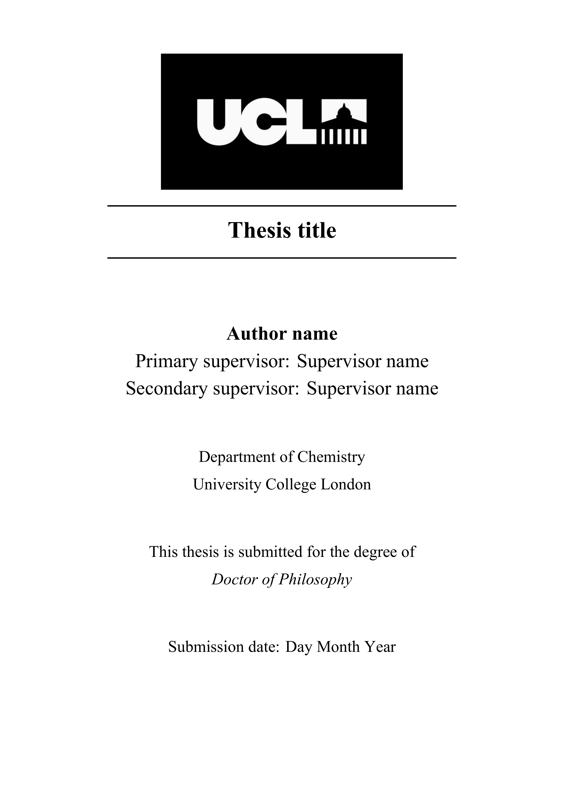
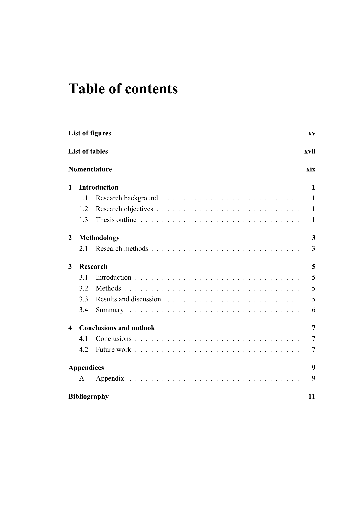

# UCL PhD thesis LaTeX template

[](https://www.overleaf.com/docs?snip_uri=https://github.com/YuxuanTang2002/ucl-phd-thesis-template/archive/refs/heads/main.zip&main_document=main.tex)
[](https://github.com/YuxuanTang2002/ucl-phd-thesis-template/blob/main/LICENSE)

An unofficial LaTeX template for PhD theses at University College London (UCL), created by a PhD student in the Department of Chemistry.
The template is designed in accordance with [UCL's thesis formatting guidelines](https://www.ucl.ac.uk/study/doctoral-school/regulations/essential-procedures-and-policies/thesis-preparation-submission-and-publishing).

## Preview

Click on either image below to view the full PDF.

<p align="center">
  <a href="preview/thesis_template.pdf">
    
  </a>
  <a href="preview/thesis_template.pdf">
    
  </a>
</p>

## Usage

The template is organized around `main.tex`, which includes the front matter, main chapters, appendices, and bibliography. Edit the corresponding `.tex` and `.bib` files to customize the thesis content and references.

### Overleaf

Click the **Open in Overleaf** badge to import the template into a new Overleaf project. Set the compiler to **LuaLaTeX** in the project settings.

### Local compilation 

Download this repository as a ZIP file or clone it using Git:

```bash
git clone https://github.com/YuxuanTang2002/ucl-phd-thesis-template.git
```
Compile the project using **LuaLaTeX** with a suitable LaTeX distribution.

## License

The template is licensed under the [MIT License](LICENSE), but the use of the UCL logo 
is separately subject to [UCL's branding guidelines](https://www.ucl.ac.uk/brand-and-experience/brand/visual-guidelines/logo/logo-guidelines) and applicable permissions.
